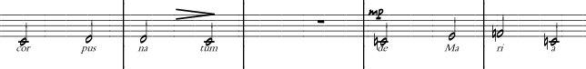
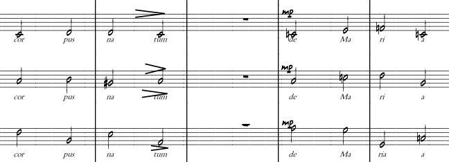

# TASK301 – Introduction to Formal Languages and Theory of Computation

Author: Lais Salvador

Team Members: Edeyson Gomes, Jéssica Santana,  Marcos Bião

## Topics addressed by the problem

- Formal languages
- Language representation
- Operations on languages

## Problem description

An art collector owns musical scores and recordings that need to be catalogued and processed using a computer. The collector is very particular about how this material is handled and guarantees that, for every piece of music in the collection, the score corresponds exactly to its recording.

Some scores are for a single instrument; others are for several instruments. A score for one instrument can be viewed as a sequence of musical symbols. Scores for several instruments can also be viewed as sequences, but with compound symbols: each element of the sequence consists of a finite number of musical symbols. Each piece of music may contain an arbitrary number of symbols.

The following examples show scores for one instrument and three instruments, respectively.

### One instrument

Each note can be viewed independently as a symbol written on a staff. In the next example, each of the three instruments has a representation similar to the one above: each instrument has its own staff, and the notes are aligned across the staves at each beat.

### Three instruments

Each piece of music may belong to one or more musical genres. For each genre, the collector needs to define which pieces belong to it. Some genres consist of a finite set of pieces, whereas others are defined more generally by their time signature. For example, the waltz genre consists of all pieces in 3/4 time.

The collector accepts no errors in the answers to the questions below. Each answer must leave no doubt about its correctness. A mathematical justification must therefore be provided for every question.

Theory of Computation provides tools for answering these questions: each musical note can be viewed as a symbol used to construct sequences representing scores for a single instrument.

## Questions

Answer the following questions as a group, always justifying each answer.

1. Can every piece of music be viewed as a string?
2. Is it possible to form a piece of music by concatenating other pieces? Can the result also be called a piece of music?
3. Is an excerpt from a piece of music also a piece of music? Can the excerpt occur at the beginning, in the middle, or at the end of the original piece?
4. If a piece of music were rewritten in reverse order, from the end to the beginning, could the result also be considered a piece of music? Which operation would produce this reversed piece?
5. The collector states: “My collection of rock music contains 3,500 pieces. I also have a set of 700 operas and a set of pieces I would like to write, although that set currently contains no pieces.” To help the collector during this period of creative inactivity, define the sets and answer the questions below.

   a) The set of pieces formed from the opening excerpts—the first 20 notes—of each rock piece in the collection.

   b) The set formed by repeating the same piece 0, 1, 2, 3, 4, 5, … times.

   c) The set containing only the empty piece, which has no notes.

   d) The set of romantic songs: {m | m is a song containing the word “amor” (“love” in Portuguese) in its lyrics}.

   e) The set of pieces that are operas or romantic songs.

   f) The set of pieces that are both opera and rock.

   g) Given collections of waltzes for flute, piano, trumpet, and cello, how can a collection of waltzes for all four instruments combined be obtained?

   h) Is it possible to have the collection of all pieces that are not operas?

   i) Given each score and its corresponding MP3 file, can they be used interchangeably? Can one be viewed as an encoding of the other?

## Attribution

Activity based on the problem *Coleção de Músicas* (*Music Collection*) by Professor Martin Musicante, UFRN.
