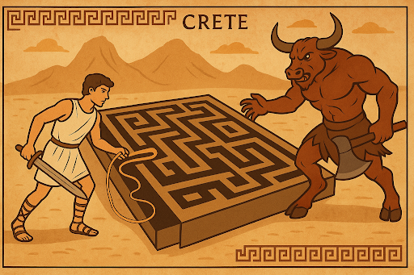

# TASK302: The Minotaur's Labyrinth

Author: Laís Salvador

Collaborators: Edeyson Gomes, Marcos Bião, Jéssica Santana

Date: October 2025

## 1. Problem

On the ancient island of Crete, King Minos ordered the construction of a labyrinth so intricate that even the winds would lose their way through its corridors. It was said that no one—neither human nor god—could find the way out after entering. In the shadows of this maze of tunnels lived the feared Minotaur, a creature with a human body and a bull's head, guardian of mystery and fear.

Like every good myth, however, the story found a new hero: Theseus. Guided by Ariadne's ingenuity, he carried only a thread, a sword, and great courage. As he advanced, he unwound the thread, leaving a trace of his journey—an invisible map that could lead him back if he survived the monster.

Today, thousands of years later, the Ariadne Foundation wants to retell this legend as a digital educational game in which each player becomes a modern Theseus. The challenge is to reconstruct the labyrinth and create a navigation mechanism that allows the hero both to find the Minotaur and to return safely to the entrance.

The game's navigation module has a limitation: the character can reach the Minotaur but cannot find the way back. The development team needs a formal solution that allows Theseus to remember the route and find the exit.

Your team has been hired as formal-language engineers to investigate how to represent this navigation computationally, respecting the constraints of formal language and automata theory, with support from the JFLAP simulator.

The Ariadne Foundation is also interested in a formal notation specifying rules for generating location sequences. This notation should support documentation and improvements to the navigation module for Theseus and other characters that may be added to the game.

> The puzzle is set: how can Ariadne's thread become a formal method?

## 2. Challenges

- What limitations does a finite automaton encounter when representing memory of the route taken?
- What auxiliary memory device could allow Theseus to remember previous movements?
- How can Theseus's route be documented using a formal notation for location rules?
- What adaptations would be needed if the labyrinth had multiple exits or dynamic obstacles?

## 3. Development Stages

1. Problem understanding: discuss the challenge and identify what is already known and what needs to be learned.
2. Research and independent learning: investigate automata, stacks, grammars, and formal modeling.
3. Prototyping and simulation: use JFLAP to create candidate models and test hypotheses.
4. Failure analysis and refinement: justify choices and assess the limitations of each approach.
5. Scientific documentation: write a technical article in the SBC format describing the investigation, results, and contributions.

## 4. Deliverables

One team member must submit the following through moodle.ufba.br by 11:59 p.m. on November 3, 2025:

- A JFLAP file containing Theseus's navigation module, formally representing the outward and return journeys through the labyrinth.
- A technical report in the Brazilian Computer Society (SBC) format containing:
  - a detailed description of the module's operation;
  - the operations performed during navigation;
  - at least two simulation examples;
  - generation of location sequences using formal notations;
  - reflections on the investigation, limitations, main difficulties, and proposed solutions.

## 5. Knowledge and Concepts

- Pushdown Automata
- Context-Free Grammars
- Automata Theory
- Formal Modeling with JFLAP

## 6. Learning Objectives

### General Objective

Develop a formal navigation module for Theseus that computationally represents the return to the starting point using concepts from formal languages and automata.

### Specific Objectives

- Understand the navigation challenges in the Minotaur's labyrinth.
- Investigate auxiliary memory devices in finite-state machines.
- Propose a formal notation specifying rules for generating location sequences to support system documentation and improvement.
- Use JFLAP to simulate navigation and validate the model.

## References

RAMOS, M. V. M.; JOSE NETO, J.; VEGA, I. S. *Linguagens Formais: Teoria, Modelagem e Implementação.* Bookman, 2009.

MENEZES, Paulo Blauth. *Linguagens formais e autômatos.* 6th ed. Bookman, 2011.
