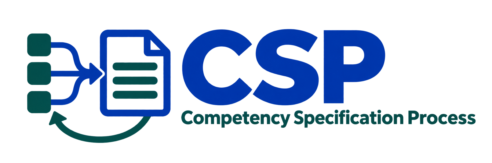

# Competency Specification Process (CSP)



The **Competency Specification Process (CSP)** organizes the formulation, review, and maintenance of competence specifications in Computing Education. It connects instructional demands to reusable definitions, qualified task–competency associations, and decisions about catalog maintenance.

The CSP was developed within doctoral research at the Federal University of Bahia (UFBA). Its reference process, reporting instruments, and decision guidance were consolidated through documentary analysis of **25 task applications across four cycles**. These applications produced two catalogs: **Theory of Computation** and **introductory programming**.

The repository contains task descriptions, specifications, review and adjustment records, cycle registries, mappings, and supporting instruments. These materials make the documented decisions available for examination. They describe educational expectations and their intended uses; they are not, by themselves, evidence that learners attained the specified competencies.

## Start here

- **Apply the process:** use the [reporting instruments](CSP/reports/).
- **Examine the applications:** start with the README and data dictionary of the relevant [cycle](CSP/cycles/).
- **Consult the Theory of Computation catalog:** see [Catálogo](Cat%C3%A1logo/) and the cycle-specific registries.
- **Compare maintained definitions and uses:** consult the [cross-cycle matrix](CSP/cycles/CSP-Cross-Cycle-Task-Competency-Matrix.md), [lifecycle account](CSP/cycles/CSP-Cross-Cycle-Competency-Lifecycle.md), and [post-cycle refinement report](CSP/cycles/CSP-Post-Cycle-Refinement-Report.md).
- **Inspect the earlier collaborative materials:** see [TAREFAS - LOMc](TAREFAS%20-%20LOMc/README.md), subject to the sharing precautions below.
- **Explore formal representation:** consult the separate [OntoKSD repository](https://github.com/eduknowgpt/OntoKSD).

## What the CSP helps decide

The process examines whether the performance required by an instructional task can use an existing competence definition or requires a specification change. Its guidance addresses:

- **Contextual qualification:** retain the definition and document its intended contribution, mode of use, conditions, and evidence expectations in the task association.
- **Revision:** change a definition or its constituents, documenting the adopted adjustment and applicable specification state.
- **Specialization:** identify a narrower specification, its base, and the commitments supporting that relationship.
- **Composition:** identify component competencies and the performance expected from their coordinated use. Co-occurrence in a task does not establish composition.
- **Separate specification:** introduce a distinct definition when the required performance is not adequately represented by existing specifications.
- **Curricular correspondence:** document the external expectation, relationship, scope, and rationale without assuming equivalence or complete coverage.
- **Maintenance:** distinguish recommendations, adopted changes, withdrawn proposals, and unresolved interpretations.

Shared knowledge or terminology alone is insufficient to justify reuse. The comparison must consider the action, knowledge object, defining conditions, and constituents of the referenced specification.

## Reference process and instruments

The reference process connects four activities. The reporting instruments use the phase labels **1A, 1B, 2, and 3**. Analysis, specification, and review may reopen earlier decisions; the activities are not a mandatory one-pass sequence.

| Activity | Main work | Instrument |
| --- | --- | --- |
| **Phase 1A — Instructional analysis** | Identify required actions, products, conditions, relevant knowledge, and the intended educational setting. | [Instructional Entity Analysis Report](CSP/reports/CSP-Instructional-Entity-Analysis-Report.md) |
| **Phase 1B — Competency specification and contextual association** | Compare instructional demands with available definitions; propose constituents and describe the intended task association. | [Phase 1 Report Template](CSP/reports/CSP-Report-Template.md) |
| **Phase 2 — Review and documented adjustment** | Examine clarity, scope, knowledge–skill pairings, dispositions, evidence expectations, and the rationale for specification decisions; record recommendations and their treatment. | [Review Report Template](CSP/reports/CSP-Review-Report-Template.md) |
| **Phase 3 — Semantic consolidation and maintenance** | Examine the catalog as a set; document reuse, revision, specialization, composition, curricular correspondence, and maintained states. | [Semantic Structuring Guide](CSP/reports/CSP-Structuring.md) |

The guides and historical reports preserve terminology from their respective documentary states. In particular, a report's use of “validated” denotes its documented review outcome, not independent certification of educational effectiveness. Review may be separate or integrated with collaborative specification; do not infer a separate review event when the source does not record one.

## Application cycles

| Cycle | Context and analytical emphasis | Task packages |
| --- | --- | ---: |
| [Cycle 1](CSP/cycles/cycle-01/README.md) | Initial specification and review in Theory of Computation; delimitation of knowledge, actions, and relationships. | 5 |
| [Cycle 2](CSP/cycles/cycle-02/README.md) | Reuse, contextual qualification, revision, and specialization in Theory of Computation. | 4 |
| [Cycle 3](CSP/cycles/cycle-03/README.md) | Existing catalog informing task development, followed by examination and maintenance of the resulting specifications. | 5 |
| [Cycle 4](CSP/cycles/cycle-04/README.md) | Introductory programming in technical secondary education; explanatory components, compositions, and qualified BNCC Computação correspondences. | 11 |
| **Total** | **Four documentary application cycles** | **25** |

Cycles 1–3 develop the Theory of Computation catalog. Cycle 4 uses a separate introductory-programming catalog, identified by CM codes. It should not be treated as the next version of the same catalog. Likewise, four application cycles do not mean four complete methodological versions of the CSP.

Task packages are located under each cycle's `en/` directory; teaching-plan materials are under `syllabus/`. Cycle 3 directories use TASK301–TASK305, while some documentary references retain earlier TASK25.xx labels. Use the cycle's source accounts to interpret these identifiers rather than creating new identities from naming differences.

## Repository structure

```text
OCSP/
├── README.md
├── CSP/
│   ├── images/
│   │   └── csp-logo.png
│   ├── reports/
│   │   ├── CSP-Instructional-Entity-Analysis-Report.md
│   │   ├── CSP-Report-Template.md
│   │   ├── CSP-Review-Report-Template.md
│   │   └── CSP-Structuring.md
│   ├── cycles/
│   │   ├── cycle-01/
│   │   ├── cycle-02/
│   │   │   └── assessment-traceability/
│   │   ├── cycle-03/
│   │   ├── cycle-04/
│   │   ├── CSP-Cross-Cycle-Competency-Lifecycle.md
│   │   ├── CSP-Cross-Cycle-Task-Competency-Matrix.md
│   │   └── CSP-Post-Cycle-Refinement-Report.md
│   └── registry/                         # Currently empty; use cycle registries
├── Catálogo/                            # Theory of Computation entries and lifecycle accounts
├── TAREFAS - LOMc/                       # Earlier collaborative documents and versions
├── OCSP.vpp                             # Visual Paradigm project
└── OntoKSD.md                           # Local explanatory note; see the separate ontology repository
```

This is a navigation summary of the local structure checked on **24 November 2026**, not an inventory of every file. The cross-cycle files are under `CSP/cycles/`, not the currently empty `CSP/registry/` directory.

### Reading cycle data

Each cycle provides a README, data dictionary, competency registry, task–competency mapping, matrix, and lifecycle records. Cycle 4 additionally provides `CSP-Competency-Composition.csv`.

| File | Purpose |
| --- | --- |
| `CSP-Competency-Registry.csv` | Definitions and identifiers within the cycle's documented scope. |
| `CSP-Task-Competency-Mapping.csv` | Task associations and their recorded qualifications and status. |
| `CSP-Competency-Task-Matrix.md` | Human-readable comparison of the documented associations. |
| `CSP-Competency-Lifecycle.csv` | Source-supported creation, reuse, and selected maintenance events. |
| `CSP-Data-Dictionary.md` | Field definitions, counting conventions, and source precedence. |
| `CSP-Competency-Composition.csv` (Cycle 4) | Component relationships, separate from direct task associations. |

Read the dictionary before calculating totals. Task–competency links, distinct identifiers, component memberships, and historical rows are different counting units. A reused identifier does not establish that its wording was unchanged in every copy. Interpret differences using the applicable source state and documented adjustments.

The post-cycle refinement report is a later consolidation of Cycles 1–3. It must not be presented as a review decision contemporaneous with every original application. The catalogs and lifecycle files preserve available history, not a complete edit or approval log.

Some supporting files mentioned in individual documents may belong to a separate generation workspace or release. Check availability before following rebuild instructions; their mention does not establish that all dependencies are included here.

## Relationship with earlier PEC/LOMc work

The [TAREFAS - LOMc archive](TAREFAS%20-%20LOMc/README.md) contains earlier collaborative materials associated with Edeyson Gomes and Jéssica Santana and with Santana's master's research on the **Processo de Especificação de Competências (PEC)** and LOMc. It includes task versions, competency tables, annotations, reviewer suggestions, process documents, and RDF examples.

These materials document the shared development trajectory. Their terminology, identifiers, and organization must be interpreted within their own versions. They are not interchangeable with the current cycle registries or proof that every element of the consolidated CSP already existed in the earlier process.

## Relationship with OntoKSD

The CSP organizes specification work and its documentary products. **OntoKSD** represents selected specification content and links to curricular references, qualified instructional uses, and assessment records. CSP problems and decisions contributed to its requirements; ontology structures do not replace the justification of those decisions.

Use the [OntoKSD repository](https://github.com/eduknowgpt/OntoKSD) for the ontology, formalization, queries, and evaluation artifacts. The local `OntoKSD.md` is an explanatory note, not the authoritative description of the evaluated ontology version.

The [Cycle 2 assessment-traceability package](CSP/cycles/cycle-02/assessment-traceability/README.md) contains supplementary materials for examining a retrospective Task202 judgment. Keep this assessment-related use distinct from CSP reports of intended competencies and instructional evidence expectations.

## Evidence and interpretation

The applications support examination of specification decisions in the investigated settings. They do not establish comparative effectiveness, reduced authoring effort, complete curricular coverage, or independent reproducibility. An instructional association identifies an intended contribution; an assessment judgment requires its own evidence and criteria. Neither an ontology encoding nor successful retrieval independently establishes learner attainment or educational validity.

For verification, cite the task, source file, specification state, and relevant passage. For reuse of this repository, record the commit or archived release used rather than relying only on a mutable branch. Human-readable reports, CSV records, and formal encodings may preserve different parts of the documentary account.

## Sharing and attribution

Review materials must be checked for names, code-to-name keys, comments, tracked changes, metadata, and links exposing identified participants before public distribution. The presence of reviewer codes does not certify anonymization of the whole archive. Preserve research originals separately from the copy prepared for sharing.

Author credits and attribution to task sources are distinct from participant identities. This README does not assign a repository-wide license or override rights and permissions stated in individual resources. Check the applicable conditions before redistributing or adapting materials.

## Citation

A related publication presents the CSP:

```bibtex
@inproceedings{Edeyson2026CSP,
  author    = {Gomes, Edeyson and Salvador, Laís and Cerqueira, Marcos},
  title     = {A Process for Competence Specification in Computing Education},
  booktitle = {Anais do XXXVII Simpósio Brasileiro de Informática na Educação},
  year      = {2026},
  pages     = {1332--1345},
  publisher = {SBC},
  address   = {Porto Alegre, RS, Brasil},
  doi       = {10.5753/sbie.2026.27786},
  url       = {https://sol.sbc.org.br/index.php/sbie/article/view/45694}
}
```

When using particular task materials, the earlier PEC/LOMc work, or external curricular content, also cite the corresponding sources. The repository is available at [github.com/eduknowgpt/OCSP](https://github.com/eduknowgpt/OCSP).
